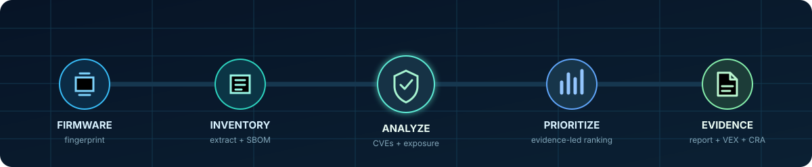
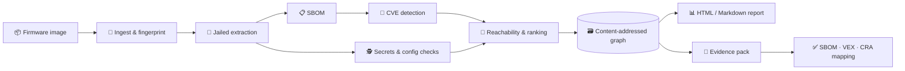

# 🛡️ FirmGraph

### The open evidence layer for firmware security

[](https://github.com/atharvaawatade/FirmGraph/actions/workflows/ci.yml)
[](LICENSE)
[](pyproject.toml)
[](docs/zero-egress.md)
[](tests/)

<p align="center">
  
</p>

**One local command turns a firmware image into a reproducible security graph, prioritized
findings, SBOMs, CRA-mapped evidence, and VEX documents. Your firmware never leaves the machine.**

FirmGraph orchestrates proven open-source tools—**unblob, Syft, and Grype**—then adds the evidence
layer they do not provide: deduplication, reachability analysis, honest confidence, deterministic
prioritization, release diffs, CRA Annex I mapping, and an audit-ready evidence pack.

> 💡 **The simple idea:** scanning tells you what might be wrong; FirmGraph helps you prove what
> matters, why it matters, and what changed.

<p align="center">
  <a href="#try-it">Try it now</a>&nbsp;&nbsp;·&nbsp;&nbsp;
  <a href="#pipeline">See the pipeline</a>&nbsp;&nbsp;·&nbsp;&nbsp;
  <a href="#quickstart">Read the full quickstart</a>&nbsp;&nbsp;·&nbsp;&nbsp;
  <a href="docs/honest-limits.md">Know the limits</a>
</p>

## ✨ Why FirmGraph

| 🔍 Discover | 🎯 Prioritize | 📦 Prove |
|---|---|---|
| Safely extract hostile firmware and build a provenance-rich SBOM | Reduce thousands of version matches to an explainable action list | Export deterministic reports, VEX, CRA mapping, and complete evidence |
| Detect CVEs, secrets, insecure services, and weak configuration | Use KEV, EPSS, ELF linkage, service exposure, and kernel config | Compare releases with content-addressed graph data |

## 📦 What a scan gives you

| For engineering | For security | For audit & compliance |
|---|---|---|
| Component inventory, release diff, full findings JSON | CVEs, secret/config checks, exposure signals, ranked remediation | Manifest, SBOM, OpenVEX, CycloneDX VEX, CRA Annex I mapping |
| Answers: *What changed?* | Answers: *What should we fix first?* | Answers: *What evidence do we have?* |

<a id="pipeline"></a>

## 🗺️ End-to-end flow

<p align="center">
  
</p>

<p align="center"><sub>Animated data flow: each stage records provenance, so results remain explainable and reproducible.</sub></p>



<a id="try-it"></a>

## 🚀 Try it now

```bash
git clone https://github.com/atharvaawatade/FirmGraph.git
cd FirmGraph

# Run the bundled offline demo
./demo.sh

# Or scan your own firmware through Docker
mkdir -p out
docker build -t firmgraph .
docker run --rm --network=none \
  -v "$PWD:/work:ro" -v "$PWD/out:/out" \
  firmgraph scan /work/firmware.bin -o /out
```

Outputs include an HTML report, Markdown report, complete findings, SBOMs, graph data, CRA
mapping, and OpenVEX/CycloneDX VEX documents. See [Quickstart](#quickstart) for more options.

> 🔒 **Privacy by design:** the recommended scan is read-only and network-disabled. Secrets are
> redacted from findings, and the optional AI explainer is off by default.

> **This README is written to be verifiable, not aspirational.** Every claim below maps to a stage,
> a tool, or a test. The [Honest limitations](#honest-limitations-read-this) section is not
> boilerplate — read it.

---

## What it is / what it is not

| It IS | It is NOT |
|---|---|
| An orchestration + evidence layer over unblob/Syft/Grype | A new vulnerability scanner or a new CVE database |
| Version-match CVE detection + secrets/config rules | A source-code SAST tool or a fuzzer |
| A reproducibility + prioritization + reporting engine | A compliance *determination* — "we draft, you sign" |
| Fully local / air-gapped, deterministic | A magic false-positive eliminator (it *manages* noise, honestly) |

---

## The pipeline — every stage, the real tool, what actually happens

`firmgraph scan <image>` runs **11 stages** in sequence (`firmgraph/scanner.py`). Each stage is a
Template-Method class (`firmgraph/stages/`) that records its own provenance into the scan manifest.
Data flows through a mutable `ScanContext`. Determinism comes from content-addressing + pinned
tools, not from executor cleverness.

**In plain terms:** think of it as a **home inspection for firmware**. We fingerprint the box, open
it up, make an inventory of everything inside, check each item against a list of known problems,
look for anything dangerous left lying around (keys under the doormat, doors left unlocked), sort
the problems from *"fix this now"* to *"noted for later"*, and hand you a signed inspection folder.

```
 image  ── the firmware file, e.g. a router update  router-fw-v1.2.bin
   │
 [1] ingest    Fingerprint the file (SHA-256) + detect its type → give the scan a name
   │           ↳ plain words: "what exactly is this, and let's label it so we can compare later"
   │
 [2] extract   Open the box: unblob (main) → binwalk (backup), inside a safety JAIL
   │           ↳ plain words: "unpack the firmware into its files — and say honestly how much we
   │             actually got out (94%? or only 1% because it's encrypted?)"
   │
 [3] sbom      Make an inventory list of every ingredient inside (Syft) — no duplicates
   │           ↳ plain words: "what software is in here? e.g. OpenSSL 1.0.2u, BusyBox, curl…"
   │
 [4] detect    Check each ingredient against the 'known problems' list (Grype + built-in DB)
   │           ↳ plain words: "which of these have publicly-known security holes (CVEs)? and which
   │             are so old there's no fix at all?"
   │
 [4a] binscan  A second inspector double-checks unlabeled items (cve-bin-tool)
   │           ↳ plain words: "backup checker — currently out of order, so we skip it and say so"
   │
 [5] checks    Look for dangerous things left lying around (secrets, telnet on, root login open)
   │           ↳ plain words: "any passwords/keys hardcoded in the box? any doors left unlocked?"
   │             (we blank out the actual secret — the report never leaks it)
   │
 [6] enrich    Sort the problems: which are actually dangerous vs. only theoretical
   │           ↳ plain words: "of 3000 issues, these 9 are being exploited in the wild RIGHT NOW —
   │             start here. the rest are background noise."
   │
 [6a] explain  Optional: a plain-English note on each top problem (AI, only if you add a key)
   │           ↳ plain words: "why does this matter and what should I check?" — never a verdict
   │
 [7] graph     File everything in a system that remembers (so we can compare v1.2 vs v1.3 later)
   │           ↳ plain words: "the tool has a memory — next release, it tells you what changed"
   │
 [8] report    Write the inspection report (a web page + text): summary first, details after
   │           ↳ plain words: "the thing you actually show your boss or an auditor"
   │
 [9] export    Hand over the evidence folder (SBOM, findings, CRA map, VEX — you sign it)
                ↳ plain words: "the audit-ready pack — we prepared it; you review and sign"
```

### [1] ingest — identity
SHA-256 of the whole image, size, and format detection by magic bytes (squashfs `hsqs`, gzip,
xz, ubi, uImage…). Produces a stable `scan_id` = `sha256[:12]-timestamp`. This is the anchor for
history and diff.

### [2] extract — the hardest 20%, jailed
Firmware is **hostile input**, so extraction runs behind adapters and a security jail
(`firmgraph/security/jail.py`):
- **Engine chain** (`firmgraph/adapters/`): `unblob` native (in the Docker image) → `unblob` via
  Docker (on dev hosts) → `binwalk` fallback. First engine to produce files wins; every attempt
  is recorded.
- **Jail**: path-traversal guard, symlink-escape removal (a crafted `etc → /etc` can't make us
  walk the host), decompression-bomb budgets (file count / bytes / depth), per-stage timeouts.
- **Confidence** = unblob's own chunk-identification ratio. A 1%-extracted encrypted image is
  reported as **1% confidence with a red banner**, never as a clean "0 findings."
- unblob writes `unblob.log` to its CWD → we run it from a writable dir so a **read-only** firmware
  mount (which we recommend) never crashes it (`tests/test_unblob_adapter.py`).

### [3] sbom — what's inside, with provenance
`Syft` (`firmgraph/adapters/syft.py`) catalogs components from **package databases** (dpkg, apk,
rpm, portage…) and **binary classifiers**. Each component carries:
- **provenance** (which cataloger/signal found it) and a **confidence**: 0.9 package-DB-backed,
  0.6 binary-classified, 0.7 other.
- We **de-duplicate** by `(name, version, type)` — overlay filesystems (OpenWrt's `/rom`) expose
  the package DB twice, so scanners naïvely list every package twice. We don't.
- Exports: CycloneDX 1.x, SPDX 2.3, syft-json (the last is what Grype consumes).

### [4] detect — CVE matching
`Grype` (`firmgraph/adapters/grype.py`) matches the SBOM against a **vulnerability DB baked into
the Docker image** (`/opt/grype/db`). This is how "works air-gapped, zero setup" is *true* — you
can't be offline and download a 1.7 GB DB.
- **KEV** (CISA Known-Exploited) and **EPSS** (exploitation probability) ride in on the same DB —
  one snapshot, one date recorded in the manifest, no second feed to reconcile.
- `GRYPE_DB_AUTO_UPDATE=false` for determinism; `GRYPE_DB_VALIDATE_AGE=false` so the pinned DB
  keeps working past grype's 5-day staleness cutoff (offline for real, not a fuse).
- **EOL evidence**: a CVE with no fixed version is kept as *"no fix available (EOL evidence)"* and
  mapped to CRA II.8 — something a raw CVE list never says.

### [4a] binscan — the second engine (honest status: not producing findings)
`cve-bin-tool` (`firmgraph/adapters/cve_bin_tool.py`) is wired as a **separate** engine that
fingerprints components in stripped binaries Syft can't name — shown in its own report section,
**never merged** with Grype (two engines disagree with no ground truth). **The pinned version
(3.4) has an upstream scan-time crash**, so today it produces **0 findings** and is reported as a
clean *"skipped (unhealthy)"* — never a failure. Enabling it is a tracked V0.2 item.

### [5] checks — what CVE scanners miss
A YAML rulepack (`firmgraph/checks/rulepacks/v1.yaml`) over the extracted filesystem: hardcoded
private keys, root password hashes, AWS keys, telnet-at-boot, `PermitRootLogin yes`,
`PermitEmptyPasswords`, world-writable `/etc`. **Deliberately conservative** (high-confidence
rules only) and **redaction-by-default** — a discovered secret's value never enters a finding,
only its location + a sha256 prefix. Binaries are never content-scanned.

### [6] enrich — turning the firehose into a short list
1. **Dedup** findings by `(cve, component, kind, source)`.
2. **Reachability ladder** — each layer speaks only where it has evidence, silent otherwise:
   - *filesystem presence* (`enrich/reachability.py`) — binary in a PATH dir, lib in a lib dir, or
     referenced in init/systemd;
   - *ELF dynamic linkage* (`enrich/elf_reachability.py`) — parses `DT_NEEDED`/`DT_SONAME`, builds
     the load closure; a library present but linked by **nothing** is downgraded;
   - *service exposure* (`enrich/service_exposure.py`) — a vulnerable component that's a network
     daemon **started at boot** is the remote attack surface, promoted in ranking.
3. **Kernel-config filter** (`enrich/kernel_config.py`) — the noise-killer: reads the kernel's build
   config and marks CVEs in **provably-absent subsystems** `not_affected` with the config line as
   proof (collapses the kernel version-match flood).
4. **Suppression** (`firmgraph/triage/`): shareable YAML rules; marking a false positive is
   remembered locally and captured as a TP/FP label (never transmitted).
5. **Ranking** (`firmgraph/enrich/ranking.py`), deterministic tiers each with a reason:
   `P1 KEV > P2 EPSS≥10% or direct-evidence > P3 reachable/network-exposed+severe > P4 severe > P5 rest`.

### [6a] explain — optional AI, explainer never judge
`LiteLLM` (`firmgraph/triage/explainer.py`), BYO key. It writes plain-English "why it matters /
what to check" — it **never** decides true/false-positive (that stays deterministic). Output is
advisory-labeled, cached, and lives **outside** the graph so model drift can't affect
reproducibility. Off by default; ships only after a human-scored 50-finding gate.

### [7] graph — content-addressed, diffable
Every node's id = SHA-256 of its canonicalized content (`firmgraph/graph/`), stored in SQLite.
Two scans of identical content → identical ids → `diff` is a set operation and reproducibility is
testable (`tests/test_determinism.py`). `firmgraph diff v1 v2` reports component version changes,
CVEs resolved/introduced — and **warns if the vuln-DB snapshot differs** so a DB update isn't
misread as a firmware regression.

### [8] report — readable at enterprise scale
HTML + Markdown, deterministic ordering:
- **Executive summary**: components, findings by severity, act-now (P1–P3) vs backlog, KEV count,
  no-fix count.
- **Findings by component**: the kernel's thousands of CVEs collapse to **one row with a ⚠
  version-match flag** instead of 3000 rows.
- **Flat findings capped at 100** by priority; the complete unabridged list is always in
  `evidence-pack/findings.json`.
- **CRA Annex I table** (`firmgraph/cra/`) — rule-based, best-effort, "not legal advice."
- **VEX summary** — affected / not_affected / under_investigation counts.

### [9] export — the evidence pack
`evidence-pack/`: `manifest.json` (the reproducibility receipt — tool versions, DB snapshot date,
per-stage provenance), `findings.json` (complete record), `cra-mapping.json`, **`vex.openvex.json`
+ `vex.cdx.json`** (OpenVEX + CycloneDX VEX — suppressed→not_affected with your reason,
unreachable→under_investigation, rest→affected, deduped per CVE, "manufacturer signs" in
metadata), plus the SBOMs and `graph.json`.

---

## Tools we use (exact, pinned)

| Tool | Version | Role | License |
|---|---|---|---|
| [unblob](https://github.com/onekey-sec/unblob) | 26.6.4 | Firmware extraction (primary) | MIT |
| binwalk | 3.x | Extraction fallback | MIT |
| [Syft](https://github.com/anchore/syft) | 1.46.0 | SBOM / component discovery | Apache-2.0 |
| [Grype](https://github.com/anchore/grype) | 0.115.0 | CVE matching + baked vuln DB | Apache-2.0 |
| [cve-bin-tool](https://github.com/intel/cve-bin-tool) | 3.4 | Binary-signature engine (**broken upstream — skipped**) | GPL-3.0 |
| LiteLLM | ≥1.40 | Optional AI explainer (BYO key) | MIT |
| CISA KEV + FIRST EPSS | via Grype DB | Exploitability signal | — |

Runtime: Python 3.12+ (3.14 in the image), Typer+Rich (CLI), pydantic v2 (typed boundaries),
SQLite (graph), Jinja2 (reports). Base image: `ghcr.io/onekey-sec/unblob` (extractor deps
included). **Image size ≈ 3.2 GB** — on purpose: it ships a complete offline vulnerability DB.

---

## Architecture

- **Pipes & Filters** — 11 sequential stages, each recording provenance.
- **Ports & Adapters (Hexagonal)** — every external tool sits behind a typed port
  (`firmgraph/ports/`). Swapping unblob→EMBA, Syft→X, or Grype→Y is one adapter file + one
  registration line. Broken tools degrade gracefully (see cve-bin-tool).
- **Content-addressed graph** — reproducibility + diff for free.
- **Provenance manifest** — tool versions + DB snapshot dates in every scan = the audit receipt.
- **Security-first** — firmware treated as hostile input; extraction jail; non-root container;
  air-gapped by default.

---

## Honest limitations (read this)

FirmGraph is deliberately transparent — this is the credibility, not a disclaimer.

1. **cve-bin-tool (second engine) produces 0 findings** — v3.4 crashes upstream; we handle it as a
   clean skip. Real second-engine coverage is a tracked V0.2 item.
2. **Kernel / version-match floods** — matching `linux-kernel@6.6.73` pulls in **thousands** of
   CVEs, most for drivers not compiled in. FirmGraph reads the kernel's **build config** and rules
   out CVEs in provably-absent subsystems (with the config line as proof) — but **only on positive
   proof**, and only when the image ships a readable config; otherwise it groups + prioritizes +
   caps and says so. Read a big *raw* kernel count as "N known CVEs," not "N things to fix."
3. **SBOM binary identification is partial** — Syft names components with package metadata or known
   binary signatures; unidentified stripped binaries are a **false-negative surface** we don't hide.
4. **Reachability is a layered heuristic, not proof** — filesystem presence + ELF dynamic linkage
   (`DT_NEEDED`) + network-service exposure; misses `dlopen`/proprietary launchers and static
   linkage; not applicable to RTOS/monolithic images. Call-graph / taint reachability is a later
   rung — not claimed today.
5. **checks rulepack v1 is small** — a handful of high-confidence rules; zero findings on a clean
   image is intended, not thoroughness.
6. **CRA mapping is best-effort, rule-based** — harmonized standards aren't final; it's evidence
   organization, **not legal advice**, and needs a compliance-professional review before launch.
7. **AI explainer** is optional, off by default, and unproven until its 50-finding gate passes.
8. **The image is ~3.2 GB** (offline DB). That's the honest cost of a real air-gapped promise.

Full detail: [docs/honest-limits.md](docs/honest-limits.md) · status: [STATUS.md](STATUS.md) ·
the release audit that found real bugs: [AUDIT.md](AUDIT.md).

---

## Determinism & privacy (how they're enforced, not just claimed)

- **Reproducible**: same image + same tool versions + same DB snapshot → identical content-addressed
  graph. `tests/test_determinism.py` is the promise as code (green in CI on every commit).
- **Local-first**: a CI test runs a full scan under `--network=none` and asserts it succeeds. The
  open tool sends nothing anywhere; suppression labels are captured locally only. Don't take our
  word for it — run [`./prove-zero-egress.sh`](prove-zero-egress.sh) for three independent proofs
  (see [docs/zero-egress.md](docs/zero-egress.md)).
- **Honest**: low extraction confidence → red banner; a broken engine → labeled skip; every
  artifact carries the liability line.

---

## Quickstart

**Docker (recommended — CVE matching works air-gapped, zero DB setup):**
```bash
docker build -f docker/Dockerfile -t firmgraph .        # release image (~3.2GB, ships the DB)
mkdir -p out
docker run --rm --network=none \
  -v "$PWD/examples:/work:ro" -v "$PWD/out:/out" \
  firmgraph scan /work/demo-firmware.tar -o /out         # bundled example → real checks findings
open out/report.html
# scan any real firmware the same way, fully offline:
#   -v "$PWD:/work:ro"  firmgraph scan /work/firmware.bin -o /out
```

**Local (no Docker):** needs `syft` + `grype` on PATH (`grype db update` once); unblob runs via
Docker.
```bash
uv sync
uv run firmgraph scan examples/demo-firmware.tar -o out
open out/report.html
```

## Commands

| Command | What it does |
|---|---|
| `firmgraph scan <image>` | The 11-stage pipeline → graph + reports + evidence pack |
| `firmgraph diff <a> <b>` | Semantic release-over-release diff (with DB-drift caveat) |
| `firmgraph history` | Recorded scans |
| `firmgraph suppress <cve> --reason ...` | False-positive rule (shareable YAML) + local label |
| `firmgraph explain-gate <findings.json>` | Human-scored AI-explainer gate (BYO key) |

## Development

```bash
uv sync --dev
uv run pytest -q            # 67 tests incl. determinism + air-gap + report-scale
uv run ruff check firmgraph tests
uv run mypy firmgraph       # strict
```

## License

Apache-2.0 — and it stays Apache-2.0 (a public pledge; see `docs/governance.md`). The code is
everyone's; the "FirmGraph" name is ours.
